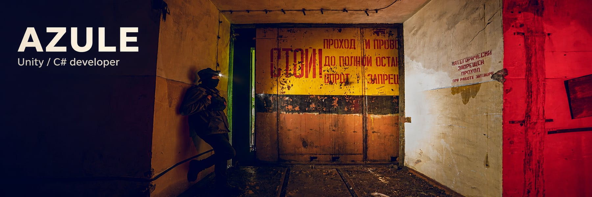
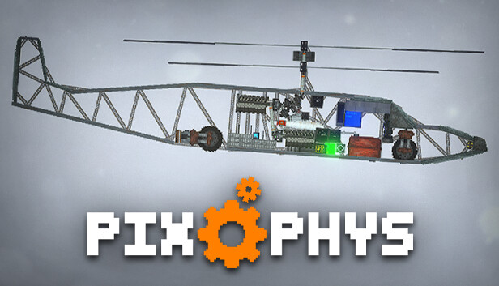
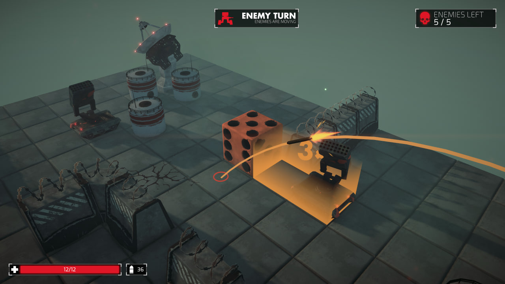

  

<h1 align="center">Maksim Evdokimov · Azule</h1>

  Unity / C# developer · Saint Petersburg

  
  
  

I'm Maksim, also known as **Azule** or **Redsham**. I work on **BUS** at **Herbarium Games** and study game development at **ITMO University**, where I'm a third-year bachelor's student.

I've been making games with Unity since 2020 and working with Unreal Engine since 2023. I like building systems players can experiment with: assembling a machine, wiring up its controls, or figuring out how to turn a dice roll into a good tactical move.

## Games I've worked on

<table>
  <tr>
    <td width="50%" valign="top">
      
      <h3><a href="https://store.steampowered.com/app/1558100/PixPhys/">PixPhys ↗</a></h3>
      
UNITY · C# · ENGINEERING SANDBOX

      
My 2D engineering sandbox on Steam. Build machines with simulated electricity and fuel systems, program them with nodes, and extend the game with C# mods.

      
I'm currently working on its next update.

    </td>
    <td width="50%" valign="top">
      
      <h3><a href="https://redsham.itch.io/dice-n-roll">Dice ’n Roll ↗</a></h3>
      
UNITY · TURN-BASED TACTICS

      
Turn-based tactics with a mechanical die as your character. Every move changes its orientation and the attacks you can make.

      
We presented the game at KRI 2026.

    </td>
  </tr>
  <tr>
    <td width="50%" valign="top">
      <h3>BUS</h3>
      
HERBARIUM GAMES · UNITY · PHOTON FUSION

      
The team project I work on as a Unity developer at Herbarium Games, using Photon Fusion for multiplayer.

    </td>
    <td width="50%" valign="top">
      <h3>На Дне / Na Dne</h3>
      
UNREAL ENGINE 5 · UNIVERSITY TEAM PROJECT

      
Our university team project in Unreal Engine 5, built around physics-based construction and climbing out of a deep pit.

    </td>
  </tr>
</table>

More games and jam projects are on **[itch.io](https://redsham.itch.io/)**.

## What I work with

  
  
  
  
  
  

Most of my work is in **C# and Unity**: gameplay, physics, networking, UI, and tools. I use **URP, Photon Fusion, VContainer, UniTask, R3, Addressables, and Burst/Jobs** across my projects.

I also work with **C++ and Unreal Engine 5**, and use **Blender, Substance Painter, and Aseprite** when a project needs visual work.

## Away from the editor

**Industrial photography · Travel · Gravel cycling**

I photograph industrial sites, abandoned buildings, and old machinery. I travel with friends, bring a camera along, and ride a gravel bike. Industrial architecture and the details of how machines are built interest me just as much as the photos themselves.

## Find me

[Telegram](https://t.me/Redsham) · [Email](mailto:maksim.evdokimov.work@gmail.com) · [itch.io](https://redsham.itch.io/)
